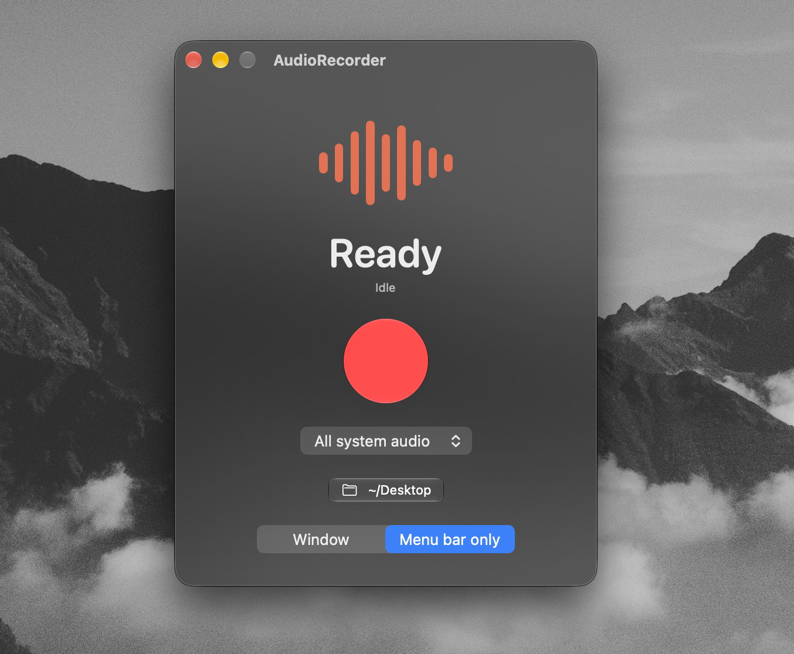

# AudioRecorder

[](https://github.com/kai-thelonious/Audio-Recorder/actions/workflows/ci.yml)

A small macOS app that records everything your Mac is playing — music, videos, calls — to a WAV file.

It uses Core Audio process taps, so it captures system audio directly: no virtual audio driver, no loopback device, and it works the same whether you're listening on speakers, headphones or Bluetooth.

<p align="center">
  
</p>

## Requirements

- macOS 14.2 or later (CI builds and runs the tests on macOS 15 and macOS 26; macOS 14 has not been tested)

## Usage

1. Open AudioRecorder.
2. Optionally click **Choose Folder…** to pick where recordings are saved (defaults to `~/Music`).
3. Optionally pick a **Source**: **All system audio** (default) or a single app that is currently playing audio (Spotify, Safari, Music, …). The list refreshes while you're not recording; the choice is remembered and the picker is locked during a recording. Per-app recordings include the app name in the file name, e.g. `Recording Spotify <date> <time>.wav`. If the chosen app isn't running or isn't playing yet, the app tells you instead of recording everything.
4. Click **Record**. The first time, macOS asks for permission to capture system audio — click **Allow**.
5. Click **Stop**. The recording is saved as `Recording <date> <time>.wav` (16-bit PCM, stereo).
6. Click **Trim** to open the editor: drag the start and end handles on the waveform, press **Play** (or Space) to preview the selection, then **Save Trim**. The trim is written as `<name> (trimmed).wav` next to the original, which is never modified.
7. Drag the **Drag file** chip into Finder or a DAW to copy the file (the trimmed version once saved, otherwise the original).

### Menu bar mode

AudioRecorder always shows a menu bar icon (a waveform, which turns into a red record symbol while recording). Click it to start/stop recording, see the current folder and status, choose a folder, or quit.

Use the **Mode** picker (in the window or the menu bar menu) to switch between:

- **Window** – the normal app with a window and Dock icon.
- **Menu bar only** – no Dock icon and no window on launch; everything is in the menu bar. Choose **Show Window** in the menu to bring the window back temporarily.

The mode and the save folder are remembered between launches.

If nothing but silence has been captured three seconds into a recording, the window shows a "No audio detected" hint. It appears when nothing is playing, and also when the permission was denied, because macOS then delivers silence instead of an error.

If you denied the permission by accident, enable AudioRecorder under
**System Settings → Privacy & Security → Screen & System Audio Recording → System Audio Recording Only**.

## Building from source

1. Open `AudioRecorder.xcodeproj` in Xcode.
2. Build and run (⌘R). Without an Apple Developer team the app is signed ad hoc, which is enough to run it on your own Mac.

To sign with your own team (for example to distribute the app), copy `Config/Local.xcconfig.example` to `Config/Local.xcconfig` and set `DEVELOPMENT_TEAM` in it. That file is git-ignored, so your team ID never ends up in the project file or in a commit. Please don't set the team in Xcode's **Signing & Capabilities** tab, because that writes it into the project file.

## How it works

The recorder creates a global `CATapDescription` tap of all system audio, wraps it in a private aggregate device with no sub-devices (so it runs on the tap's own clock and sample rate), and writes the buffers it receives to disk with `AVAudioFile`. See `AudioRecorder/MyApp.swift`.

## Running the tests

In Xcode press **⌘U**, or from a terminal:

```bash
xcodebuild test -scheme AudioRecorder -destination 'platform=macOS'
```

The tests cover the logic that doesn't need audio hardware: file naming, the level meter, saved settings, the recorder view model (with a fake recorder) and the trim/export code.

## Project structure

```
AudioRecorder/
  App/          app entry point and scenes
  Models/       plain data types and helpers (AppMode, AppSettings, AudioApp, RecordingFileName, TrimSource)
  Services/     Core Audio recording (`TapRecorder`), app/process discovery, waveform loading, folder picker
  ViewModels/   observable state for the views (RecorderViewModel is shared by the window, menu bar and trim editor)
  Views/        SwiftUI views and shared styling
AudioRecorderTests/   unit tests (Swift Testing)
Config/       build settings (Shared.xcconfig; your own signing goes in the git-ignored Local.xcconfig)
```

## Contributing

Changes go through a pull request: branch off `main`, fill in the pull request template (summary, test plan, what isn't covered), and make sure the CI checks pass. User-visible changes get a line under **Unreleased** in [CHANGELOG.md](CHANGELOG.md).

## License

[MIT](LICENSE)
